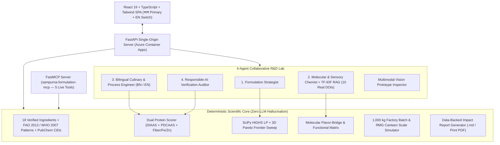

<p align="center">
  
</p>

<h1 align="center">Sampurna AI (সম্পূর্ণা AI)</h1>
<p align="center">
  <strong>Molecular, Pareto &amp; Multi-Agent Plant-Protein Formulation Platform</strong><br />
  <a href="https://sampurna-ai.jollygrass-e2685ed1.japaneast.azurecontainerapps.io"><strong>Live Application</strong></a> ·
  <a href="https://www.figma.com/design/RMK4SKZQjjE9PGH6wOHLdL"><strong>Figma Design System</strong></a> ·
  <a href="docs/PRODUCT_OVERVIEW.md"><strong>Product Overview</strong></a> ·
  <a href="docs/IMPACT_REPORT.md"><strong>Impact Report</strong></a> ·
  <a href="docs/DEMO_WALKTHROUGH.md"><strong>Demo Walkthrough</strong></a>
</p>

---

## 1. The Problem (Bangladesh & Global Protein Deficit)
Bangladesh ranks near the bottom globally in quality animal-protein intake (**~186th out of 189 countries** at just **~4.5–5 kg of meat per person per year**, or **~12 g/day**), because animal protein costs **৳32–৳73 per 20 g edible protein** (broiler chicken yield-adjusted ~৳32.08, boneless beef ~৳73.17, eggs ~৳39.68) and drives severe agricultural greenhouse gas emissions (`931 g – 9,705 g CO₂e` per 20 g protein). Families fall into the cereal **"rice trap"**: affordable staples like red lentil (*masoor dal*) and white rice are **nutritionally incomplete** on their own—lentils are deficient in sulfur amino acids (`Met+Cys`, DIAAS `0.610`), while rice is deficient in lysine (`Lys`, DIAAS `0.623`). This chronic quality-protein and micronutrient deficit drives **~24% childhood stunting** (~32% in low-income households) and **>40% iron-deficiency anemia** and muscle fatigue among women and RMG garment workers. Meanwhile, commercial plant-based meat analogues suffer from beany lipoxygenase off-notes (*hexanal*, *2-pentylfuran*), poor fibrous bite, or unverified nutritional claims.

## 2. Solution Overview
**Sampurna AI** (*সম্পূর্ণা* — "Complete") is an AI-native **Molecular, Nutritional & Sustainability Formulation Copilot** that designs complete, ultra-affordable, low-carbon alternative protein products from locally available Bangladeshi crops, fungi, and agricultural by-products:
- **Deterministic 3D Pareto & SciPy HiGHS LP Optimizer:** Solves across `Cost × LCA CO₂e × FAO (2013) DIAAS / WHO (2007) PDCAAS` with allergen exclusions (`soy`, `gluten`, `peanut`, `sesame`), Dhaka Open Retail vs. TCB Subsidized pricing tiers, and interactive Pareto knee-point selection.
- **PubChem Molecular Flavor-Bridge & Sensory Engine:** Maps volatile off-notes (*Hexanal* CID `6184`, *2-Pentylfuran* CID `19602`) against fungal umami synergy (*L-Glutamic Acid* CID `33032` + *5'-GMP* CID `135398631`) and Maillard precursors (*L-Cysteine* CID `5862` + *D-Xylose* CID `135191`) to reduce beany flavor while boosting meaty chewiness.
- **4-Agent Collaborative R&D Lab:** Translates natural-language Bangla or English R&D briefs into math-locked formulations, DOI-cited molecular explanations, bilingual EN/BN consumer recipes, 1,000 kg industrial processes, and programmatic zero-hallucination audits.
- **Multimodal Prototype Vision Inspector:** Analyzes cooked prototype photos for Maillard browning, fibrous grain, and moisture appearance (strictly labeled as *AI Visual Hypothesis*).
- **1,000 kg Factory Batch & RMG Canteen Scale Simulator + Instant Impact Report:** Computes B2B wholesale COGS, gross margin, and institutional scale savings for Bangladesh's 4M-worker RMG sector.

### Measured Flagship Impact (*Dhaka Sampurna Plant-Protein Keema*, Per 20 g Complete Protein)
| Metric | Edible Broiler Chicken | Boneless Beef | Red Lentil Alone | **Sampurna Keema Blend** | Verified Delta vs. Chicken |
| :--- | :---: | :---: | :---: | :---: | :---: |
| **Cost (BDT)** | ৳32.08 | ৳73.17 | ৳8.54 | **৳9.86** | **−69.3%** |
| **GHG Emissions (g CO₂e)** | 931.1 g | 9,705.4 g | 68.3 g | **73.9 g** | **−92.1%** *(−99.2% vs Beef)* |
| **FAO (2013) DIAAS** | 1.377 | 1.387 | 0.610 | **1.000 (Complete)** | **+63.9% vs Lentil** |

---

## 3. System Architecture



---

## 4. Repository Structure

```text
sampurna-ai/
├── assets/
│   └── logo.svg                 # Vector brand banner for documentation
├── backend/
│   ├── agent/                   # 4-Agent R&D Copilot, TF-IDF RAG & LLM client
│   ├── core/                    # Deterministic SciPy HiGHS LP, scoring, chemistry, economics & report
│   ├── main.py                  # Single-origin FastAPI server (/api/* + SPA static hosting)
│   └── mcp_server.py            # Model Context Protocol server (5 formulation tools)
├── data/
│   ├── ingredients.csv          # 14 Bangladeshi plant/fungal crops + 4 animal baselines
│   ├── reference_patterns.csv   # FAO (2013) DIAAS & WHO (2007) PDCAAS amino acid patterns
│   ├── molecules.json           # PubChem volatile & functional compound library
│   └── papers/                  # 10 peer-reviewed open-access PMC/FAO/Science papers
├── docs/
│   ├── PRODUCT_OVERVIEW.md      # 1-page architecture & impact overview
│   ├── IMPACT_REPORT.md         # Generated flagship formulation report
│   └── DEMO_WALKTHROUGH.md      # 3-minute product walkthrough script
├── frontend/
│   ├── public/                  # SVG app logo & bundled Bangla TrueType fonts
│   └── src/                     # React 19 + TypeScript + Tailwind v4 + Recharts SPA
└── tests/                       # Pytest unit & integration test suite (15 tests)
```

---

## 5. Mathematical Formulation (Linear Programming & Pareto Sweep)
For eligible plant/fungal ingredients $i \in \{1..N\}$ with protein fraction $p_i$, digestible amino acid concentration $d_i a_{ik}$ (mg/g protein), market cost $c_i$, and LCA footprint $e_i$:
$$\min_{x \ge 0} \; \text{Objective}(x) \quad \text{s.t.} \quad \sum_i p_i x_i = 20\text{ g}, \quad \sum_i d_i a_{ik} p_i x_i \ge s_{\min} r_k \cdot 20 \; (\forall k \in \{1..9\}), \quad x_i \le m_i \sum_j x_j, \quad \sum_j x_j \le M_{\max}$$
Five optimization modes (`cheapest`, `greenest`, `most_complete`, `balanced`, `meat_analogue`) plus ε-constraint sweeps over $(s_{\min}, \text{CO}_2\text{e})$ construct the non-dominated 3D Pareto frontier in <150 ms.

---

## 6. Data Sources & Responsible AI Safeguards
- **Nutrition & Amino Acids:** USDA FoodData Central + FAO (2013) Food & Nutrition Paper 92 (DIAAS) + WHO/FAO/UNU (2007) Technical Report Series 935 (PDCAAS).
- **Environmental LCA:** Poore & Nemecek (2018), *Science* (`DOI: 10.1126/science.aaq0216`) via Our World in Data; Water Footprint Network.
- **Pricing:** Dhaka Open Retail & TCB Subsidized Lists (Nov 2026), with yield-adjusted edible meat equivalence (`0.53` dressed broiler edible fraction).
- **Molecular Chemistry & Scientific RAG:** Verified PubChem Compound CIDs (`6184`, `19602`, `33032`, `135398631`, `5862`, `135191`, `34286`, `18635`, `522834`) and 10 open-access peer-reviewed papers from NCBI PMC (`PMC10743084`, `PMC9128549`, `PMC13770633`, `PMC13664611`, `PMC13409598`, `PMC13762891`, `PMC13664401`, `PMC13783529`).
- **3-Tier Epistemic Integrity:** Every output separates **VERIFIED COMPUTED** numbers (LP/scoring), **MODEL ESTIMATED** proxies (molecular/unverified LCA items marked `ESTIMATE`), and **AI HYPOTHESES** (recipes/sensory/vision tweaks requiring wet-lab & 20-person blind taste panels). Zero medical claims; full allergen labeling.

---

## 7. Quick Start (Local, Tests, MCP Server & Docker)

```bash
# 1. Install backend dependencies & run full test suite
uv sync
uv run pytest -v

# 2. Build React/Vite frontend
cd frontend && npm install && npm run build && cd ..

# 3. Start single-origin FastAPI + SPA server (works with or without .env API keys)
uv run uvicorn backend.main:app --host 0.0.0.0 --port 8000

# 4. Run standalone Model Context Protocol server
uv run python -m backend.mcp_server

# 5. Build & verify Docker container locally
docker build -t sampurna-ai .
docker run -p 8000:8000 --env-file .env sampurna-ai
```
